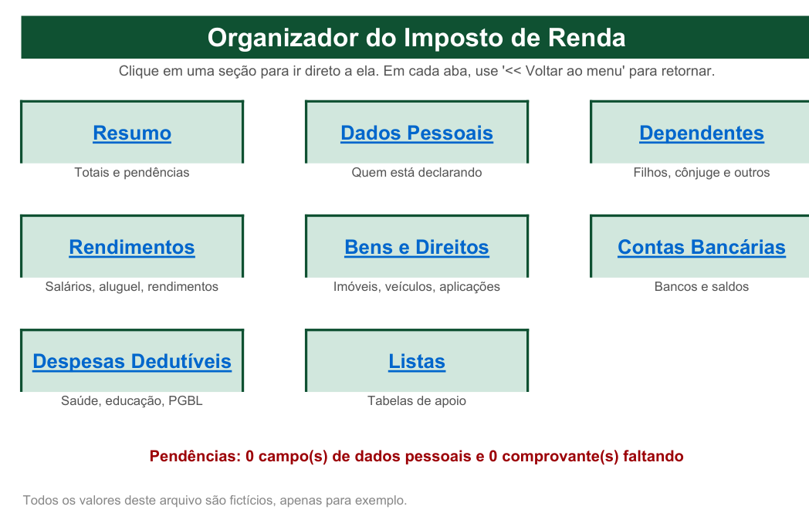
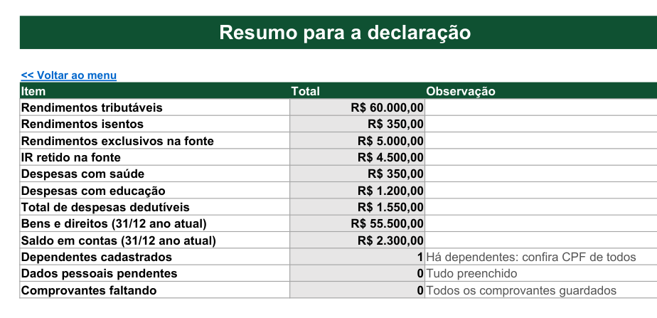
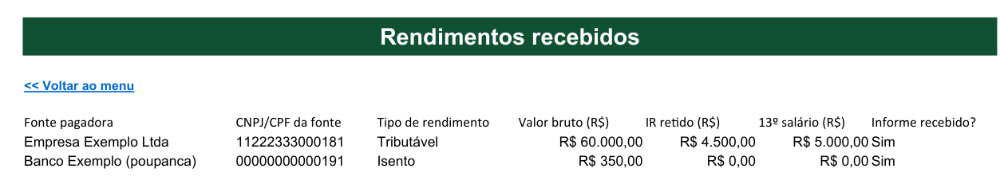
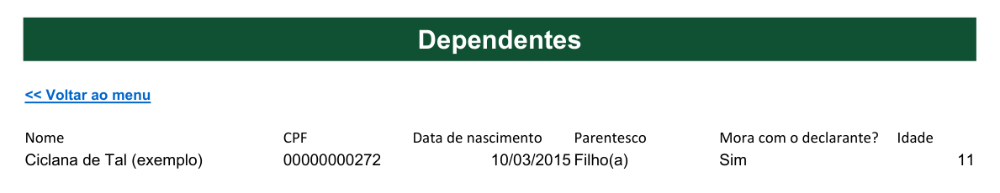
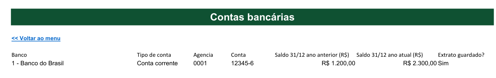

# Organizador do Imposto de Renda no Excel

Planilha que reúne, num lugar só, as informações que a gente corre atrás na hora de declarar o Imposto de Renda: dados pessoais, dependentes, rendimentos, bens, contas bancárias e despesas dedutíveis. Tem menu de navegação com links, validações automáticas em cada campo e um resumo com totais e pendências.

Projeto do Desafio de Projeto da DIO sobre agregador de dados para a declaração do IR (trilha Santander Excel 2026).

Arquivo: [`organizador-ir.xlsx`](organizador-ir.xlsx)

> Todos os dados da planilha são fictícios (CPFs e CNPJs de exemplo, nomes "Exemplo"). Apague as linhas de exemplo antes de usar com seus dados e não publique a versão preenchida.

## Telas

**Menu de navegação**: cada botão é um hiperlink para a aba; embaixo, um aviso de pendências que se atualiza sozinho.



**Resumo**: totais que vão para a declaração e o que ainda falta separar.



**Rendimentos**: tabela com validação de CNPJ/CPF, tipo de rendimento em lista e valores numéricos.



**Dependentes** e **Contas bancárias** (banco escolhido na lista com 50 instituições):





## Estrutura da planilha

| Aba | O que guarda |
|---|---|
| **Menu** | Botões com hiperlink para cada aba e contador de pendências |
| **Resumo** | Totais por categoria, número de dependentes, campos pendentes e comprovantes faltando |
| **Dados Pessoais** | Nome, CPF, nascimento, título, contato, endereço, UF e recibo da última declaração, com coluna de status (OK / Pendente) |
| **Dependentes** | Nome, CPF, nascimento, parentesco, se mora junto e idade calculada |
| **Rendimentos** | Fonte pagadora, CNPJ/CPF, tipo (tributável, isento, exclusivo na fonte), valor bruto, IR retido, 13º e se o informe chegou |
| **Bens e Direitos** | Tipo do bem, descrição, aquisição, valor em 31/12 do ano anterior e do atual e a variação |
| **Contas Bancárias** | Banco, tipo de conta, agência, conta e saldos em 31/12 |
| **Despesas Dedutíveis** | Saúde, educação, PGBL, pensão, doações: prestador, CNPJ/CPF, data, valor, para quem e se o recibo está guardado |
| **Listas** | Tabelas de apoio das validações (UFs, parentesco, tipos, bancos) |

Toda aba de dados tem um link **"<< Voltar ao menu"** no topo e as linhas de cabeçalho congeladas.

## Recursos usados

### Navegação com hiperlinks
Os botões do Menu são células mescladas com formatação de botão e hiperlink interno (`#'Rendimentos'!A1`). Em cada aba, o "Voltar ao menu" faz o caminho inverso. É o mesmo efeito do botão com ícone da aula, sem precisar de macro, então o arquivo continua `.xlsx`.

### Validação de dados
| Campo | Regra |
|---|---|
| CPF | Fórmula personalizada `=E(NÚM.CARACT(C8)=11; ÉNÚM(--C8))`: 11 dígitos, só números |
| CNPJ/CPF de fonte ou prestador | 11 ou 14 dígitos, só números |
| CEP | 8 dígitos, só números |
| E-mail | Precisa ter `@` e `.` |
| Datas | Data válida entre 1900 e hoje (não aceita data futura) |
| Valores em R$ | Número maior ou igual a zero |
| UF, parentesco, tipo de rendimento, tipo de bem, tipo de despesa, tipo de conta, banco, Sim/Não | Lista suspensa a partir de intervalos nomeados na aba Listas |

Quando o valor não passa, o Excel mostra uma mensagem explicando o que digitar.

### Tabelas e referências estruturadas
Cada aba de dados é uma Tabela do Excel (`tbDependentes`, `tbRendimentos`, `tbBens`, `tbContas`, `tbDespesas`). O Resumo soma por nome de coluna, então continua certo quando você adiciona linhas:

```
Rendimentos tributáveis  =SOMASES(tbRendimentos[Valor bruto (R$)]; tbRendimentos[Tipo de rendimento]; "Tributável")
Despesas com saúde       =SOMASES(tbDespesas[Valor pago (R$)]; tbDespesas[Tipo de despesa]; "Saúde")
Dependentes cadastrados  =CONT.VALORES(tbDependentes[Nome])
Comprovantes faltando    =CONT.SE(tbRendimentos[Informe recebido?]; "Não") + ... (uma parcela por tabela)
```

### Fórmulas de apoio
- Idade do dependente: `=DATADIF(D8; HOJE(); "y")`
- Variação do bem no ano: `=F8-E8`
- Status de cada dado pessoal: `=SE(C7=""; "Pendente"; "OK")`
- Aviso do Menu: texto montado com `&` a partir dos contadores do Resumo.

### Intervalos nomeados
`lista_uf`, `lista_parentesco`, `lista_tipo_rendimento`, `lista_tipo_despesa`, `lista_tipo_bem`, `lista_tipo_conta`, `lista_sim_nao`, `lista_bancos` (origem das listas suspensas) e `dp_status` (status dos dados pessoais, usado no Resumo).

### Base de apoio
A lista de bancos (código + nome, 50 instituições) veio do arquivo `bancos_apoio.xlsx` disponibilizado no desafio.

## Como usar

1. Abra `organizador-ir.xlsx` na aba **Menu**.
2. Entre em cada seção pelo botão, apague as linhas de exemplo e preencha as suas.
3. Use as listas suspensas; se um campo ficar vermelho de erro, leia a mensagem e corrija.
4. Volte ao **Resumo** para ver os totais e o que ainda está pendente antes de abrir o programa da Receita.

## O que aprendi

- Pensar a planilha como aplicativo: menu, navegação e mensagens de erro claras importam tanto quanto as fórmulas.
- Validar na entrada sai mais barato do que corrigir depois: CPF com 10 dígitos ou data no futuro já são barrados na digitação.
- Tabelas com referência estruturada deixam o resumo à prova de linhas novas.
- Dá para ter "botões" de navegação sem VBA, só com hiperlink interno, mantendo o arquivo `.xlsx` (o script de mover ícone da aula fica como alternativa para quem usar `.xlsm`).
